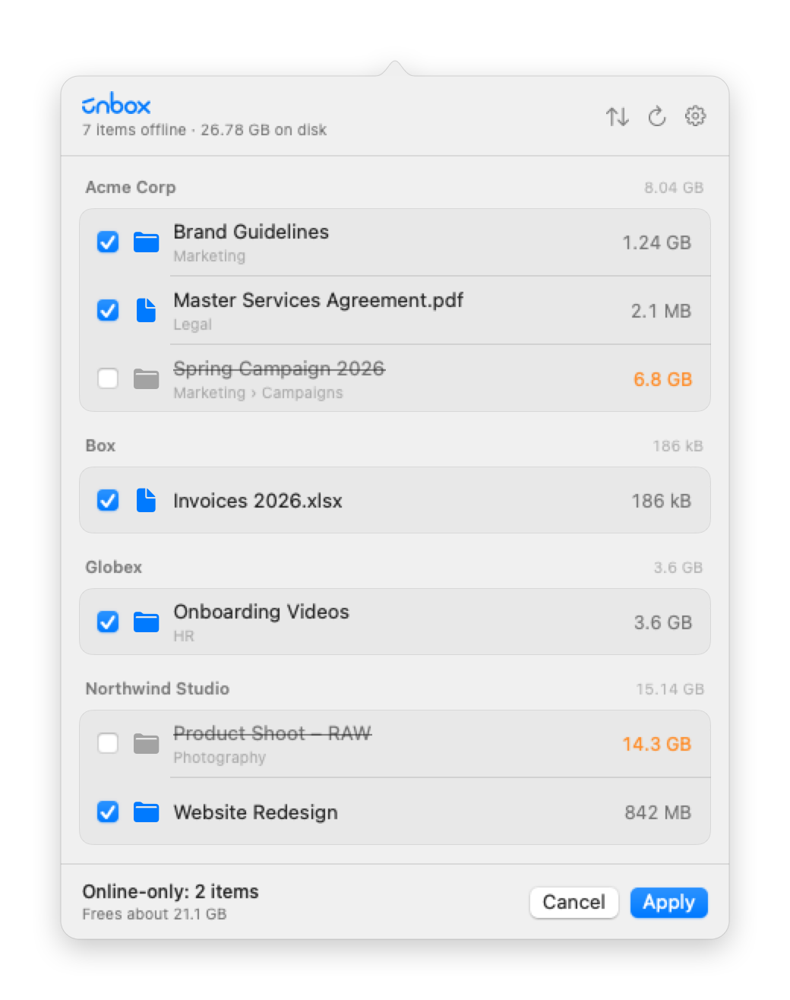
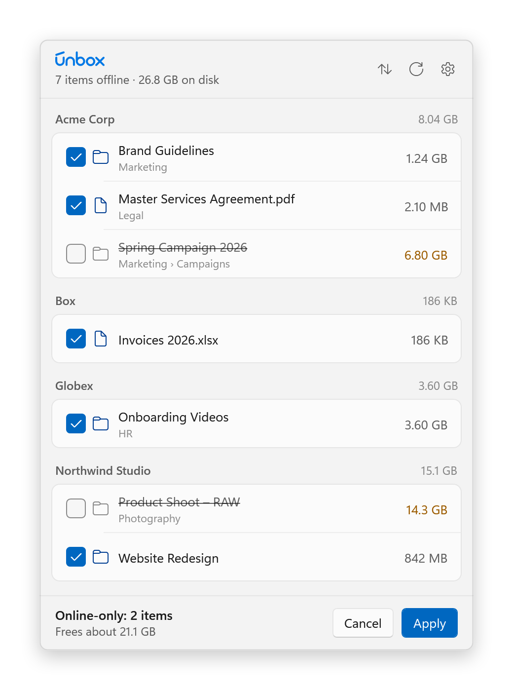
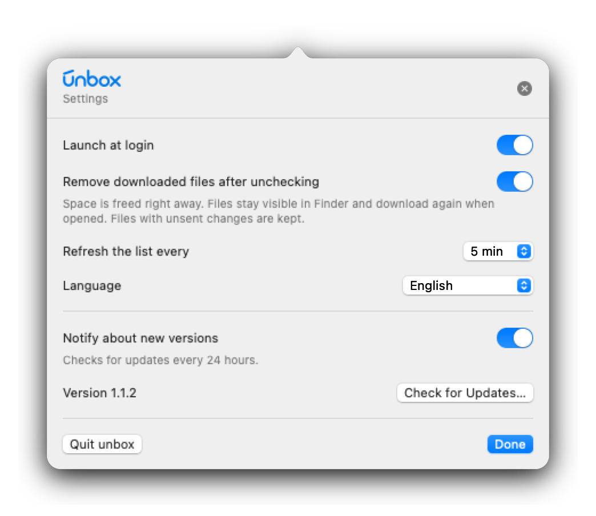
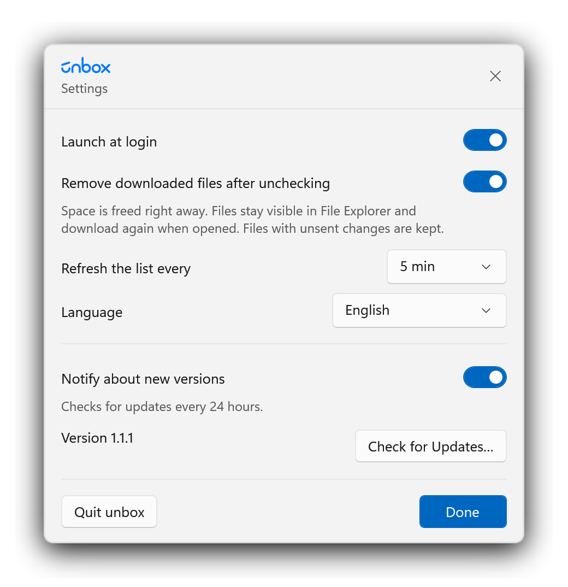

<p align="center">
  
</p>

# unbox

**See what Box Drive keeps offline on your computer – and free the space with one click.**

Box Drive lets you mark folders and files as *available offline*, but it never shows you a list of them.
unbox lives in the menu bar on macOS and in the notification area on Windows. It lists everything that is
kept offline together with the space it uses, and lets you switch items back to online-only, removing the
downloaded copies.

**[Download](https://github.com/emiterkamieni/unbox/releases/latest)** for macOS (Apple Silicon) and
Windows (x64 and Arm)
 · [Releases](https://github.com/emiterkamieni/unbox/releases)
 · [Report an issue](https://github.com/emiterkamieni/unbox/issues)
 · [Polski](README.pl.md)

<table>
  <tr>
    <td width="50%" align="center"><b>macOS</b><br>
      <picture>
        <source media="(prefers-color-scheme: dark)" srcset=".github/screenshots/macos-list-dark.png">
        
      </picture>
    </td>
    <td width="50%" align="center"><b>Windows</b><br>
      <picture>
        <source media="(prefers-color-scheme: dark)" srcset=".github/screenshots/windows-list-dark.png">
        
      </picture>
    </td>
  </tr>
</table>

<sub>The screenshots show sample data from the built-in demo mode.</sub>

## Features

- **Everything that is offline, in one list.** Folders and files kept offline by Box Drive, grouped by
  top-level folder (for example per client), with the space each one uses on disk.
- **Make items online-only.** Uncheck them and click **Apply**. unbox does what Box Drive's own
  *Make Available Online Only* (macOS) or *Free up space* (Windows) does and, optionally, removes the
  downloaded copies right away. Files stay visible in Finder / File Explorer and download again when opened.
- **Safe by design.** Files with changes that were not uploaded yet are never removed, and unbox never
  writes to Box Drive's files or downloads anything from the cloud itself.
- Sort by name or size, show items in Finder / File Explorer.
- **15 languages:** English, Polski, Deutsch, Français, Español, Italiano, Português, Nederlands, Svenska,
  Čeština, Українська, 日本語, 한국어, 简体中文 and 繁體中文. unbox follows the system language, or you
  can choose one in Settings.
- Light and dark mode, launch at login.
- **Updates:** a notification when a new version is available (checked every 24 hours) and installation
  from inside the app – [Sparkle](https://sparkle-project.org) with EdDSA-signed packages on macOS,
  [Velopack](https://velopack.io) with small delta updates on Windows.

## Requirements

| | macOS | Windows |
| --- | --- | --- |
| System | macOS 13 Ventura or later, Apple Silicon | Windows 10 22H2 (19045) or Windows 11, x64 or Arm |
| Box Drive | File Provider mode (the default on current versions), Box folder in `~/Library/CloudStorage/Box-Box` | The new Box Drive for Windows, version 2.47 or later (the default since 2.49) |

## Install on macOS

1. Download `unbox-<version>-macos-arm64.zip` from the
   [latest release](https://github.com/emiterkamieni/unbox/releases/latest). To verify the download,
   put `SHA256SUMS` next to it and run `shasum -a 256 -c SHA256SUMS --ignore-missing`.
2. Unzip it and move `unbox.app` to `/Applications`.
3. Open unbox. The app is **ad-hoc signed, not notarized by Apple**, so macOS blocks the first launch.
   Open **System Settings → Privacy & Security**, click **Open Anyway** next to unbox and confirm.
   Do not disable Gatekeeper globally.
4. The unbox icon appears in the menu bar. Turn on **Launch at login** in Settings if you like.

## Install on Windows

1. Download `unbox-win-x64-Setup.exe` (most PCs) or `unbox-win-arm64-Setup.exe` (Arm PCs such as
   Snapdragon laptops) from the [latest release](https://github.com/emiterkamieni/unbox/releases/latest).
   To verify the download, compare the output of `Get-FileHash .\unbox-win-x64-Setup.exe` in PowerShell
   with its line in `SHA256SUMS`.
2. Run it. unbox installs for your user only, without administrator rights, and starts right away.
   Until code signing is in place (see the [code signing policy](#code-signing-policy)), Microsoft Defender
   SmartScreen may show *Windows protected your PC* – click **More info → Run anyway**.
3. Windows hides new notification area icons in the overflow menu (the **^** next to the clock). Drag the
   unbox icon onto the taskbar, or turn it on in **Settings → Personalization → Taskbar → Other system tray
   icons**. Starting unbox again from the Start menu also opens its panel.

Uninstall unbox in **Settings → Apps → Installed apps**.

Later versions install from inside the app on both systems. If you use an outgoing firewall such as LuLu,
Little Snitch or a corporate proxy, allow unbox to connect to `github.com` – otherwise update checks cannot
reach the releases.

## Using unbox

Click the unbox icon to see the list. Each row shows the item, the folders above it and its size on disk;
hover over a row to show it in Finder / File Explorer.

1. Uncheck the items you no longer need offline. Their sizes turn orange – that is the space you get back.
2. Click **Apply**. unbox makes them online-only and removes the local copies.
3. A summary shows how much space was freed. Files that could not be removed (for example because they
   are open or still uploading) stay on disk and are listed in the summary.

You can still make items available offline with Box Drive in Finder / File Explorer; unbox picks them up
automatically.

### Settings

<table>
  <tr>
    <td width="50%" align="center"><b>macOS</b><br>
      <picture>
        <source media="(prefers-color-scheme: dark)" srcset=".github/screenshots/macos-settings-dark.png">
        
      </picture>
    </td>
    <td width="50%" align="center"><b>Windows</b><br>
      <picture>
        <source media="(prefers-color-scheme: dark)" srcset=".github/screenshots/windows-settings-dark.png">
        
      </picture>
    </td>
  </tr>
</table>

| Setting | |
| --- | --- |
| Launch at login | Starts unbox when you log in. |
| Remove downloaded files after unchecking | On by default. When off, Box stops keeping the files offline but leaves the downloaded copies for Box or the system to clean up later. |
| Refresh the list every | 1, 5, 15 or 30 minutes. The list also refreshes whenever you open it. |
| Language | System language or one of the 15 languages. |
| Notify about new versions | Checks GitHub for a new version once every 24 hours. |
| Check for Updates… | Checks right away and installs a new version on request. |

## How it works

On both systems unbox reads Box Drive's own offline flags (`fsnodes.markForOffline` in Box's `streemfs.db`).
Box keeps the database open, so unbox copies it together with its write-ahead log to a temporary folder and
reads only the copy; every result is then confirmed with the operating system. If Box changes its database
format, unbox falls back to asking the system about each downloaded folder (slower).

**macOS**

- Making items online-only triggers Box Drive's own `UnmarkForOffline` File Provider action – the same action
  as *Make Available Online Only* in Finder. There is no public API for running another app's File Provider
  action, so this uses internal classes of the FileProvider framework, checked at runtime.
- Space is freed with the public `FileManager.evictUbiquitousItem` API (*Remove Download* in Finder). macOS
  refuses to evict files whose changes were not uploaded yet.
- unbox never downloads cloud files itself (`IOPOL_MATERIALIZE_DATALESS_FILES_OFF`).

**Windows**

- The new Box Drive for Windows is built on the Windows Cloud Files API, like OneDrive. *Always keep on this
  device* is the pinned state of a file or folder, and *Free up space* the unpinned state.
- unbox reads the pin state from the file attributes and changes it with the documented `CfSetPinState`
  function, which any application may call. Box Drive then removes the local copies and updates its own
  offline flags – exactly as when you use File Explorer's menu.
- With *Remove downloaded files after unchecking* turned off, unbox only clears the pin, so the copies stay.
- Folders whose listing is still in the cloud are never opened, so nothing is fetched from Box.

### Privacy

unbox works entirely on your computer and does not collect or send any personal data. Its only network
requests are update checks against this repository's GitHub Releases – once every 24 hours while *Notify about
new versions* is on (the default), and when you click *Check for Updates…*. These requests are subject to the
[GitHub Privacy Statement](https://docs.github.com/site-policy/privacy-policies/github-general-privacy-statement).
No analytics, no accounts.

### Limitations

- macOS: an update can change the internal FileProvider API. unbox then shows a notice and keeps listing your
  offline items; you make them online-only in Finder instead.
- A Box Drive update can change its database format; unbox then uses the slower fallback described above.
- The previous Box Drive architecture for Windows (before 2.47) is not supported.
- Box Drive must be running to change offline settings.

unbox is an independent project and is not affiliated with or endorsed by Box, Inc.
Box and Box Drive are trademarks of Box, Inc.

## Code signing policy

Free code signing provided by [SignPath.io](https://about.signpath.io), certificate by
[SignPath Foundation](https://signpath.org).

> [!NOTE]
> Signing through the SignPath Foundation program is being set up. Until unbox is approved, the Windows
> downloads are not signed.

- **Windows:** unbox's own program files (`unbox.exe`, `unbox.dll`, `UnboxKit.dll`) and the installers
  (`unbox-win-*-Setup.exe`) are signed. They are built from this repository by
  [GitHub Actions](.github/workflows/windows.yml), and each release is approved by hand before it is signed
  ([signing configuration](.signpath/)). Components from other projects are included as published by their
  authors: the .NET runtime (signed by Microsoft) and Velopack's `Update.exe`.
- **macOS:** the app is ad-hoc signed and not notarized. Updates are accepted only with a valid EdDSA signature
  from this project's key (Sparkle).

Team roles:

- Committers and reviewers: [emiterkamieni](https://github.com/emiterkamieni)
- Approvers: [emiterkamieni](https://github.com/emiterkamieni)

Privacy policy: unbox does not collect or transfer any personal data; see [Privacy](#privacy) for the update
checks, the only network requests it makes.

## Building from source

### macOS

Xcode is not required – the Command Line Tools are enough.

```sh
scripts/build.sh             # builds build/unbox.app and build/unbox-cli
scripts/build.sh --install   # also installs to /Applications and starts the app
```

The build downloads Sparkle 2.10.1 once (pinned by SHA-256) into `.build/`.

### Windows

The Windows app is in `windows/` (C#, .NET 10, WPF with the Windows 11 Fluent theme). With the .NET 10 SDK:

```sh
dotnet build windows/src/Unbox/Unbox.csproj -c Release
dotnet publish windows/src/Unbox/Unbox.csproj -c Release -r win-x64 --self-contained -o publish
```

The projects also compile on macOS and Linux (`EnableWindowsTargeting`), but they run on Windows only.
Setting the environment variable `UNBOX_UPDATE_SOURCE` to a folder with Velopack packages makes an installed
app update from there instead of GitHub, which is useful for testing.

### Demo mode and screenshots

Both apps have a demo mode with invented folders and files that never touches Box Drive, keeps its settings
to itself and does not check for updates: `unbox.app/Contents/MacOS/unbox --demo` and `unbox.exe --demo`.
The screenshots in this README come from it:

```sh
scripts/screenshots.sh mac                    # builds unbox and saves the macOS popover, light and dark
```

On Windows, `unbox.exe --demo --language en --theme light --snapshot <folder>` (and `--theme dark`) renders
the flyout at 2x; `scripts/screenshots.sh windows <folder>` then adds the window frame and shadow.

### Command line tool

Both builds also produce `unbox-cli` (`build/unbox-cli` on macOS, `windows/src/unbox-cli` on Windows) with the
same commands:

```sh
unbox-cli list --sizes        # what is offline and how much space it uses
unbox-cli status <path>       # state of one item
unbox-cli unmark <path>       # make online-only and free the space (--keep-local to keep copies)
```

### Translations

Catalogs live in `Resources/Localizations/<language>.json`, keyed by the English text, and are shared by both
apps. English and Polish are written next to the code (`L10n.text("English", "Polski")` in Swift,
`L10n.Text(...)` in C#). After changing interface text, run:

```sh
scripts/check-localization.py   # missing keys, placeholders and plural forms, for both apps
```

### Icons

`swift scripts/make-icons.swift` regenerates all icons from the SVG logo sources in `docs/`, which are not part
of this repository: the macOS menu bar icon, logo and app icon (`Support/`), and the Windows app icon, tray
icons and logo geometry (`windows/src/Unbox/Assets/`).

### Releases

```sh
scripts/release.py 1.2.0 3             # sets the version, builds and signs the macOS app into dist/
git commit -am "Release 1.2.0"
scripts/release.py 1.2.0 3 --publish   # tags the commit and creates the GitHub release
```

Pushing the tag starts the [Windows workflow](.github/workflows/windows.yml): GitHub Actions builds the x64 and
Arm versions, packages them with Velopack (including a delta from the previous release) and adds the
installers and update packages to the same release.

Release notes are read from `release-notes/<version>.md`. The macOS ZIP is signed with the Sparkle EdDSA key
(Keychain account `unbox-Releases`, or the exported key in `~/.config/unbox/sparkle_private_key`), and the
signature is checked against the app's `SUPublicEDKey` before anything is written. The macOS update feed is
`https://github.com/emiterkamieni/unbox/releases/latest/download/appcast.xml`. Keep a backup of the private key
outside this repository – without it, existing Mac installations cannot be updated.

After publishing, `scripts/check-update.sh` marks a copy of the Mac app as version 0.9.0 and lets Sparkle update
it from the live GitHub release without any UI – feed, download, EdDSA signature and replacement included.

## License

[GPL-3.0-only](LICENSE). unbox includes [Sparkle](https://github.com/sparkle-project/Sparkle) (macOS) and
[Velopack](https://github.com/velopack/velopack), [H.NotifyIcon](https://github.com/HavenDV/H.NotifyIcon),
the [.NET Community Toolkit](https://github.com/CommunityToolkit/dotnet) and
[Microsoft.Data.Sqlite](https://github.com/dotnet/efcore) (Windows), all under the MIT license,
[SQLitePCLRaw](https://github.com/ericsink/SQLitePCL.raw) under the Apache-2.0 license, and
[SQLite](https://sqlite.org), which is in the public domain.
