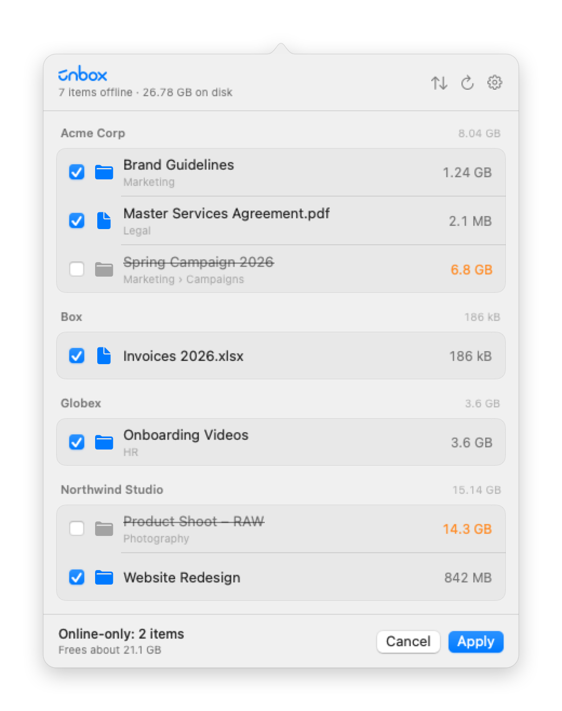
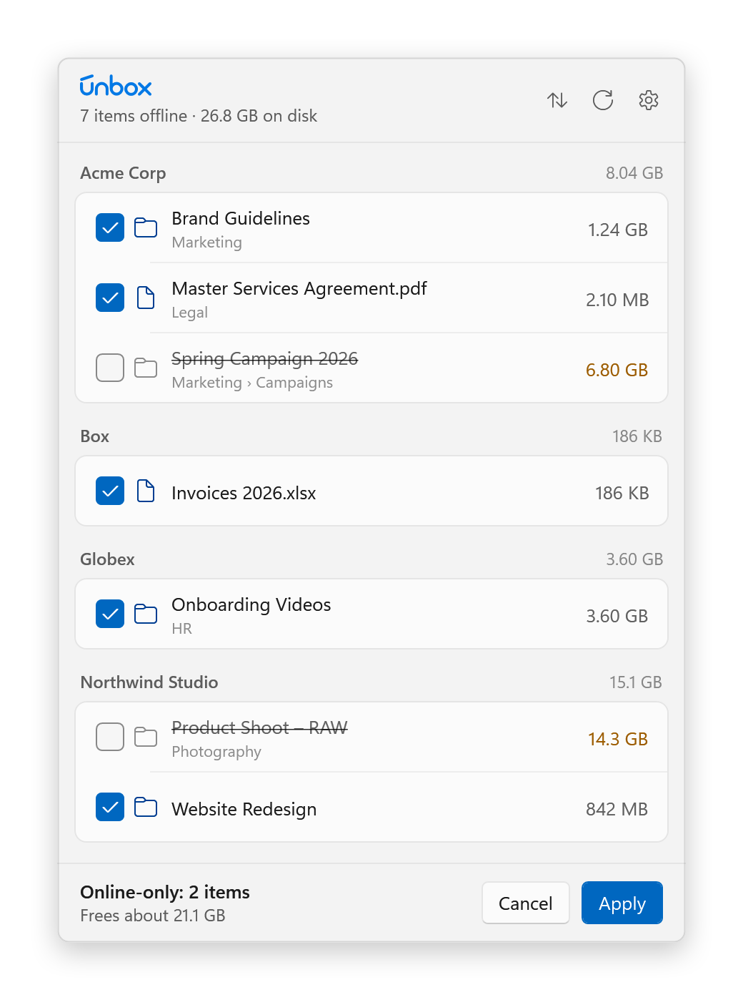

  

# unbox

**Zobacz, co Box Drive trzyma offline na Twoim komputerze – i zwolnij miejsce jednym kliknięciem.**

Box Drive pozwala oznaczać foldery i pliki jako *dostępne offline*, ale nigdzie nie pokazuje ich listy.
unbox działa w pasku menu na macOS i w zasobniku systemowym na Windows. Pokazuje wszystko, co jest
trzymane offline, razem z zajmowanym miejscem, i pozwala przełączyć elementy z powrotem na „tylko online”,
usuwając pobrane kopie.

**[Pobierz](https://github.com/emiterkamieni/unbox/releases/latest)** dla macOS (Apple Silicon) i Windows
(x64 i Arm) · [English](README.md)

<table>
  <tr>
    <td width="50%" align="center" valign="top"><b>macOS</b> 
      <picture>
        <source media="(prefers-color-scheme: dark)" srcset=".github/screenshots/macos-list-dark.png">
        
      </picture>
    </td>
    <td width="50%" align="center" valign="top"><b>Windows</b> 
      <picture>
        <source media="(prefers-color-scheme: dark)" srcset=".github/screenshots/windows-list-dark.png">
        
      </picture>
    </td>
  </tr>
</table>

Zrzuty ekranu pokazują przykładowe dane z wbudowanego trybu demonstracyjnego.

## Funkcje

- Lista folderów i plików offline pogrupowana według folderów najwyższego poziomu (np. klientów), z miejscem
  zajmowanym na dysku. Sortowanie według nazwy lub rozmiaru.
- Odznacz elementy i kliknij **Zastosuj**: unbox robi to samo co *Make Available Online Only* w Finderze
  (macOS) albo *Zwolnij miejsce* w Eksploratorze plików (Windows) i usuwa pobrane kopie. Pliki zostają
  widoczne i pobiorą się przy otwarciu.
- Pliki z niewysłanymi zmianami nigdy nie są usuwane. unbox niczego nie zapisuje do plików Box Drive
  i sam niczego nie pobiera z chmury.
- 15 języków (domyślnie język systemu), tryb jasny i ciemny, uruchamianie przy logowaniu.
- Powiadomienia o nowych wersjach (co 24 godziny) i aktualizacja z poziomu aplikacji.

## Instalacja na macOS

Wymagania: Mac z Apple Silicon, macOS 13 lub nowszy, Box Drive w trybie File Provider.

1. Pobierz `unbox-<wersja>-macos-arm64.zip` z [najnowszego wydania](https://github.com/emiterkamieni/unbox/releases/latest).
2. Rozpakuj i przenieś `unbox.app` do `/Applications`.
3. Aplikacja jest podpisana ad hoc i nie jest notaryzowana przez Apple, więc pierwsze uruchomienie zostanie
   zablokowane. Otwórz **Ustawienia systemowe → Prywatność i ochrona**, kliknij **Otwórz mimo to** przy unbox
   i potwierdź.

## Instalacja na Windows

Wymagania: Windows 10 22H2 lub Windows 11 (x64 albo Arm), nowy Box Drive dla Windows (wersja 2.47 lub nowsza).

1. Pobierz `unbox-win-x64-Setup.exe` (większość komputerów) albo `unbox-win-arm64-Setup.exe` (komputery z
   procesorem Arm) z [najnowszego wydania](https://github.com/emiterkamieni/unbox/releases/latest).
2. Uruchom instalator. unbox instaluje się tylko dla Ciebie, bez uprawnień administratora. Dopóki nie ruszy
   podpisywanie kodu (zob. [Code signing policy](README.md#code-signing-policy)), SmartScreen może pokazać
   *System Windows ochronił ten komputer* – kliknij **Więcej informacji → Uruchom mimo to**.
3. Windows chowa nowe ikony w zasobniku pod strzałką **^** obok zegara. Przeciągnij ikonę unbox na pasek
   zadań albo włącz ją w **Ustawienia → Personalizacja → Pasek zadań → Inne ikony zasobnika systemowego**.

Kolejne wersje na obu systemach instalują się z poziomu aplikacji. Jeśli korzystasz z zapory sieciowej
(np. LuLu, Little Snitch), zezwól unbox na połączenia z `github.com`.

Szczegóły techniczne, budowanie i wydawanie nowych wersji opisuje [README po angielsku](README.md).

## Licencja

[GPL-3.0-only](LICENSE). Zawiera biblioteki open source: Sparkle (macOS), Velopack, H.NotifyIcon,
.NET Community Toolkit, Microsoft.Data.Sqlite (Windows) – na licencji MIT, SQLitePCLRaw – na licencji
Apache-2.0, oraz SQLite – w domenie publicznej.
